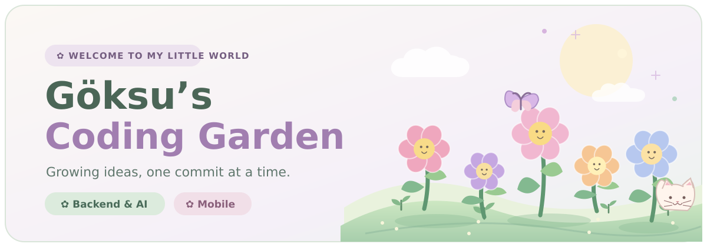

### 🌱 Hi, I'm Göksu!

**Computer Engineering Student · Backend & AI Developer**

*I plant ideas, grow them with code, and turn them into real projects.* 🌷

---

### 🌸 My Project Garden

Every flower has a little story behind it.

| My little garden | What I'm growing |
|:--|:--|
| 🪴 **SmartFridge** | An AI-assisted food management mobile app. **Flutter · Django REST · PostgreSQL** |
| 🌷 **Sign2Text** | Sign-language alphabet recognition using computer vision. **Python · OpenCV · MediaPipe** |
| 🌼 **CyclePort** | A QR-based bicycle rental and station management system. **Node.js · Express** |
| 🌺 **GB Fashion ERP** | A textile ERP featuring role-based modules and AI assistance. **Django · Docker · RAG** |
| 🌿 **Hospital Management System** | Appointments, patient management and doctor dashboards. **Python · Django** |

### 🧺 My Garden Tools

`REST APIs` · `AI / RAG` · `PostgreSQL` · `Docker` · `Git`

### 🍃 A Little About Me

- 🎓 4th-year Computer Engineering student at **Erciyes University**.
- 💻 Interested in **backend development, AI and mobile apps**.
- 🌼 I love learning by building things that solve real problems.

---

🌤️ **A little progress every day makes a garden bloom.**

[🌷 Explore my projects](https://github.com/bengoksu?tab=repositories)

